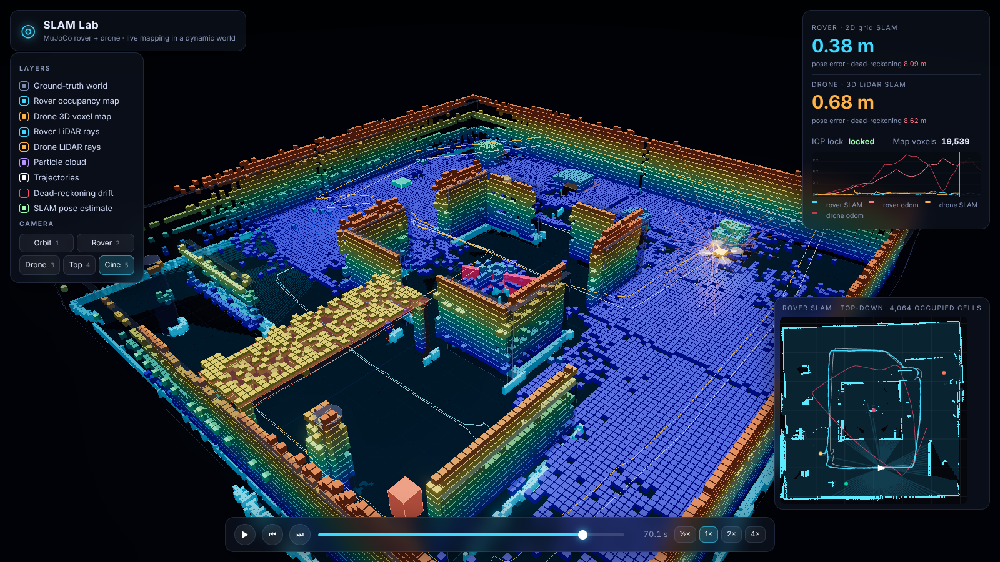

# SLAM Lab

An interactive 3D visualisation of SLAM. A **MuJoCo** ground rover and quadrotor explore a custom arena
full of moving obstacles; each builds its own map from simulated LiDAR while a **Three.js** viewer replays
the run with live maps, sensor rays, particle clouds, trajectories and error charts.



| | Rover (2D) | Drone (3D) |
|---|---|---|
| Physics | MuJoCo planar joints + velocity actuators, reactive nav | MuJoCo free body, geometric attitude controller |
| Sensor | 360° LiDAR, 10 m (`mj_multiRay`) | 96×9 beam 3D LiDAR, 12 m |
| Odometry | wheel odometry with scale error, yaw bias, noise | body-velocity + gyro with bias and noise |
| SLAM | particle filter + correlative scan match on a log-odds occupancy grid | point-to-plane ICP against a voxel map |
| Moving objects | erased from the grid by ray-casting | voxels need repeat hits to appear and are cleared when later rays pass through |

The world (walls, crates, pillars, gantry, four moving obstacles) is defined once in `slamviz/world.py` and
feeds both the MuJoCo model and the viewer.

## Run it

```bash
pip install -r requirements.txt
python -m slamviz.run            # simulate + SLAM -> viewer/data/run.json  (~40 s)
python serve.py                  # open http://localhost:8000
```

A pre-computed run (`--seed 0`) is already committed, so `python serve.py` works straight away.
Options: `--duration 80 --seed N --out path.json`. Tests: `python -m pytest tests`.

## Viewer controls

* **Space** play/pause · **← →** step · drag the timeline to scrub (maps rewind correctly)
* **1–5** camera: orbit / rover chase / drone chase / top-down / cinematic
* Layers: ground-truth world, rover grid, drone voxels (coloured by height), LiDAR rays, particles,
  trajectories, dead-reckoning drift (red) and the SLAM pose estimate (green wireframe).
* The panel shows live pose error of SLAM vs raw odometry, plus a minimap of what the rover "sees".

Everything shown is the **estimated** map, so a mismatch with the translucent ground-truth world is real SLAM error.

## Results (seed 0, 80 s)

| | SLAM RMSE | dead-reckoning RMSE |
|---|---|---|
| Rover | 0.48 m | 5.9 m |
| Drone | 0.57 m | 6.5 m |

Across seeds 0–3 the drone RMSE ranged 0.57–1.7 m and the rover 0.5–0.9 m (the rover figures for seeds 1–3
were measured before the final scan-matching tweak, so treat them as approximate). These are open-loop
trackers: there is no explicit loop closure or pose-graph optimisation, so drift is bounded by scan-to-map
matching and can grow in long featureless corridors (visible as a faint doubled wall in the rover map).

## Layout

```
slamviz/world.py       environment, movers, routes, MJCF generation
slamviz/sim.py         MuJoCo stepping, sensors, noisy odometry
slamviz/control.py     rover reactive navigation, drone geometric controller
slamviz/rover_slam.py  particle filter + scan matching + occupancy grid
slamviz/drone_slam.py  ICP + voxel map with clearing
slamviz/run.py         runs everything, exports JSON
viewer/                static Three.js app (three.js vendored, no build step)
```

Ideas to extend: loop closure / pose graph, camera-based visual SLAM, a live MuJoCo-viewer mode,
more vehicles, or swapping in your own SLAM by replacing the two `*_slam.py` classes.
